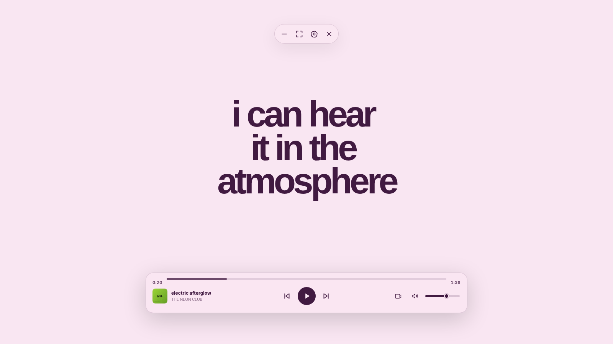

# BRAT/STAGE v4.0 · Cinematic full-screen lyrics for Spicetify

A standalone **Spotify Desktop + Spicetify** extension with word-timed BRAT-style kinetic lyrics, YouTube video backgrounds, an unobtrusive hover dock, responsive layouts, and line-triggered cinema/album color palettes. Original MIT-licensed implementation. Inspired by the visual approach of [BRAT Lyrics](https://github.com/Kiano-Ksl/brat-lyrics-spicetify); no source code from that project is bundled.



## Install or update (Windows)

1. Download `bratstage.js` from the release or build it with `python scripts/build.py`.
2. Put it in `%APPDATA%\spicetify\Extensions\bratstage.js` (replace the earlier file).
3. In PowerShell run:
   ```powershell
   spicetify config extensions bratstage.js
   spicetify apply
   ```
   If it is already enabled, only `spicetify apply` is needed.
4. In Spotify, press **Alt+B** or use the playbar button. **Alt+S** opens settings; **Esc** closes.

**Browser-only demo**: Open `preview.html` next to `bratstage.js` in a browser. It uses original mock lyrics and a simulated track. This does not verify Spotify/YouTube integration.

## v4 changes

- **YouTube link instantly applies** when a complete supported URL is pasted or typed. `Enter` confirms it; both auto-save a per-track override and switch the video on. The Load button is now optional. Background is muted so audio remains with Spotify.
- **YouTube subtitles**: `cc_load_policy=0`, best-effort `unloadModule` requests, an adjustable bottom gradient mask (0–35%), and a clipped artwork video panel. **YouTube does not offer a documented embed parameter that guarantees CC disabled for all users**. Masking can hide lower picture content. You cannot modify YouTube iframe internals from a Spicetify extension. Restricted embeds, autoplay, and some ads cannot be bypassed.
- **No spoilers**: display stays completely blank before the first synchronized lyric timestamp and between lines with explicit end timestamps.
- **Responsive dock**: raised above the desktop taskbar in windowed view, lower when the extension is truly fullscreen. Controls hide on inactivity and reveal on hover; adjust delay in Motion settings.
- **New information layout**: by default album artwork (40px), title, and artist appear **inside the dock**. Optionally show a large left album panel or hide all album info. Video placement remains configurable independently.
- **BRAT growing-square is default**. True TTML/enhanced LRC timestamps reveal words in real time with short pop transitions; the layout resizes and transitions smoothly. Locked-square, sentence, multi-line, and cinematic reveal remain available.
- **32 deliberately curated palettes**, selected deterministically per song and lyric line, with text color contrast checks; cadence: every line, every 2 lines, every 3 lines, or variable 1–3 lines. Palette transitions run up to 3 seconds.
- **Album-driven colors**: artwork pixel sampling, smoothly shifted backgrounds, and a fallback text color when needed for readability. Cross-origin artwork may prevent canvas sampling; the extension then uses existing configured colors.
- **Sync**: frame-level playhead updates with limited time interpolation, per-song ±50ms / ±250ms offset controls, imported TTML and enhanced LRC, Better Lyrics / Unison first, LRCLIB fallback.
- **Optional Better Lyrics API key** for cache misses; *separate* from the Google YouTube Data API key.

## Word timing accuracy: essential distinction

A line-synchronized LRC has only the start time of the entire line. It is **mathematically impossible to obtain exact word onset timestamps from that file alone**, without additional audio alignment or timed word data.

v4 defaults to **true word timestamps when provided** (TTML or enhanced LRC). When only line times exist, the complete line appears at its verified timestamp. An explicitly labeled *estimated timing* setting enables a heuristic word sequence, but this will not be perfectly synced to vocals. For accurate karaoke, use a song with word-timed TTML, a trusted enhanced LRC file, or provide an accurate offset in Sync settings. The Better Lyrics API may require its own API key for uncached songs.

## Video limits

- YouTube Data API v3 **only searches/matches** the official music video; it does not guarantee embedding permission or audiovisual alignment.
- Muted autoplay may be blocked by Spotify's WebView or YouTube. Some videos show errors, including privacy/referrer restrictions.
- Video + Spotify timelines can differ (different cuts or intros). Set the Video offset per user.
- `unloadModule` commands for captions are best-effort and not a guaranteed public API; the bottom mask/crop can help visually.

## Settings and shortcuts

| Feature | Where |
|---|---|
| BRAT Growing / Locked Square / Cinematic / Apple-style | Typography → Lyric composition |
| Font, letter case, auto-fit, text weight | Typography |
| Compact dock / left panel / hidden | Typography → Album artwork & track details |
| Curated / album / manual palettes | Themes → Palette source |
| Color cadence and transition duration | Themes |
| Auto-hide timeout 0.5–12 seconds | Motion |
| Background photo / GIF / YouTube | Backdrop and Sync & video |
| Live paste/Enter-to-load YouTube link | Sync & video |
| Separate optional Better Lyrics key / Google key | Sync & video |
| Sync correction, video offset | Sync & video |
| Word sync quality/fallback | Typography → Word synchronization policy |

`Alt+B` toggle overlay · `Alt+S` settings · `Esc` close · `Space` play/pause · `[`/`]` ±50 ms lyric offset · left/right arrows seek ±5s.

## Code and testing

The installable script is a deterministic bundle of `src/style.css`, `src/core.js`, and `src/extension.js`. No npm dependencies or build process beyond Python standard library.

```bash
python scripts/build.py
node --check bratstage.js
node --test tests/core.test.js tests/core_v4.test.js
python scripts/regression_v4.py
python scripts/word_sync_v4.py
```

Browser tests use a simulated Spotify Player and mocked lyric providers; they **do not** claim to test the actual Spotify/Spicetify runtime or real YouTube streaming. You should test the extension on your machine before Marketplace release. Images and demo lyrics in the preview are original and not commercial music assets.

## Attribution and references

- [Spicetify Player API](https://spicetify.app/docs/development/api-wrapper/methods/player)
- [Better Lyrics API](https://docs.betterlyrics.org/reference/get-lyrics)
- [YouTube embed parameters](https://developers.google.com/youtube/player_parameters)
- [YouTube IFrame Player API](https://developers.google.com/youtube/iframe_api_reference)
- [Kiano-Ksl / brat-lyrics-spicetify](https://github.com/Kiano-Ksl/brat-lyrics-spicetify) for aesthetic inspiration

## License

MIT. Third-party lyric data, video, album artwork, trademarks and album identities belong to their respective owners.
