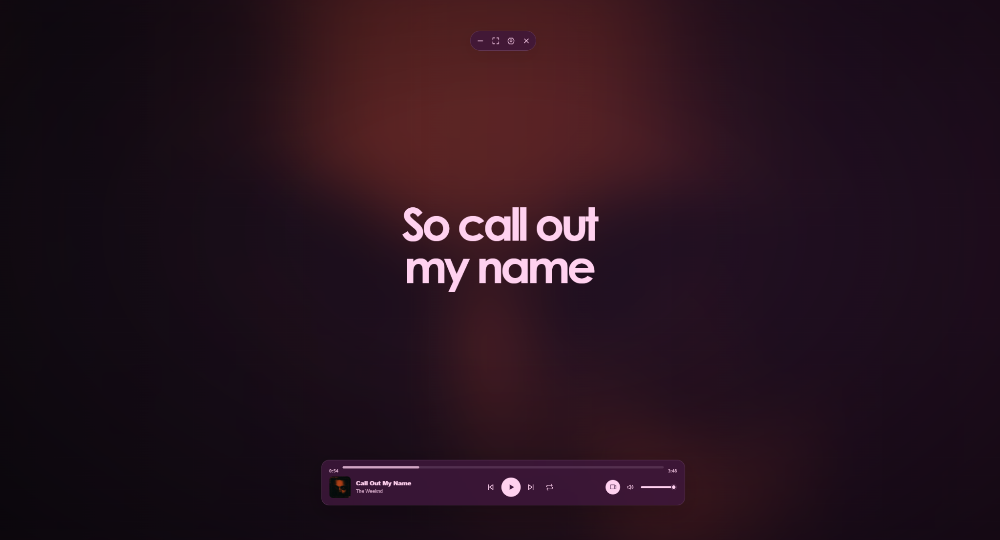
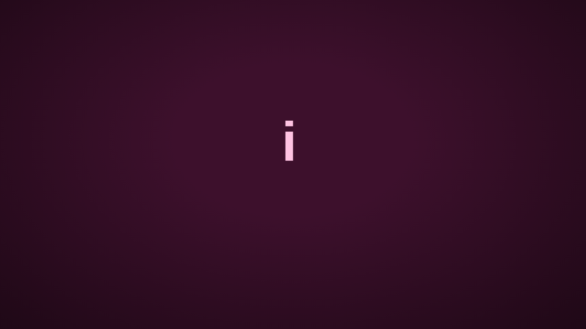
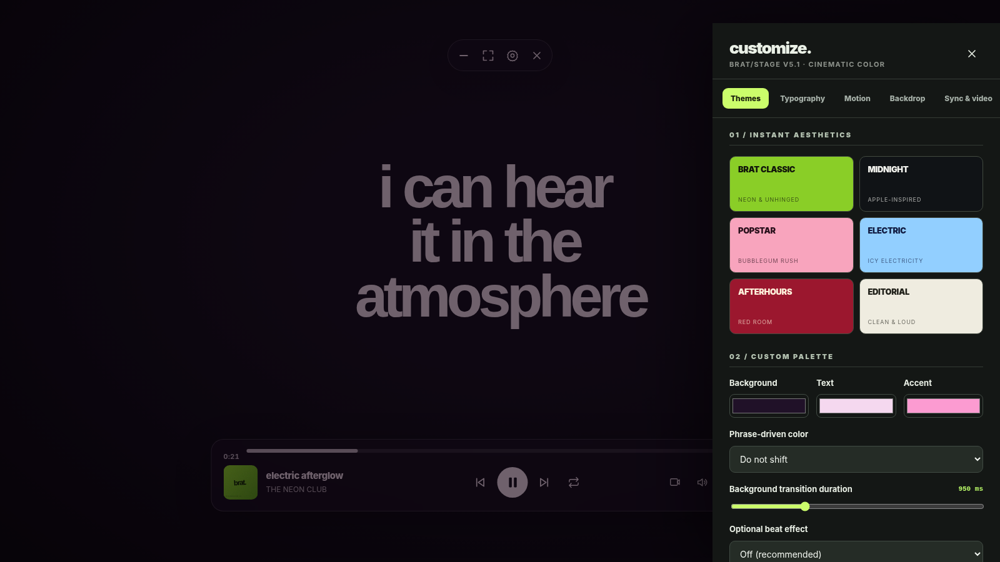
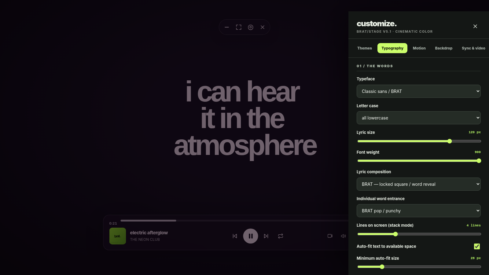
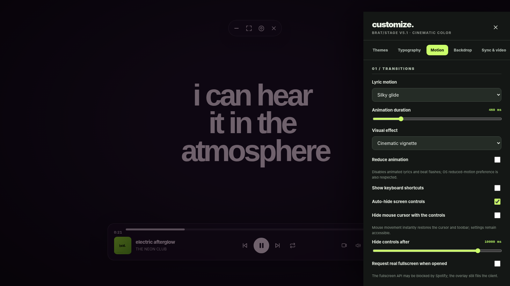
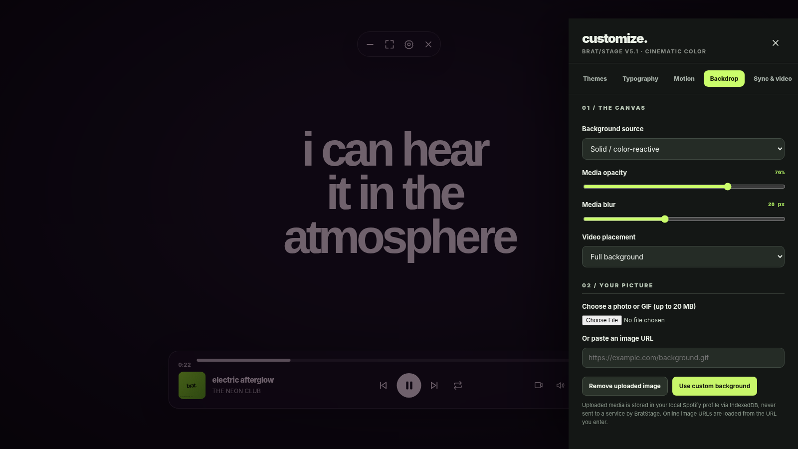
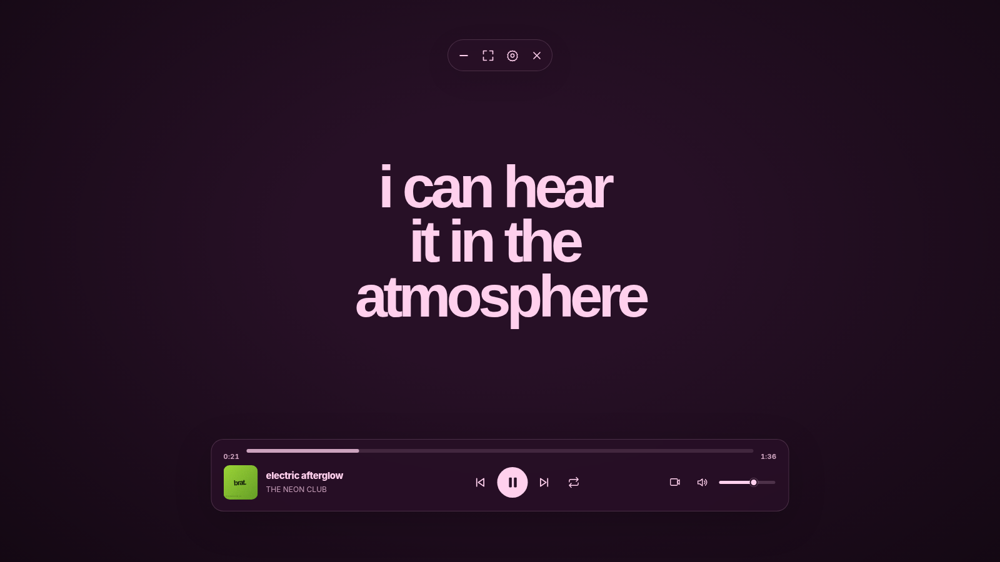
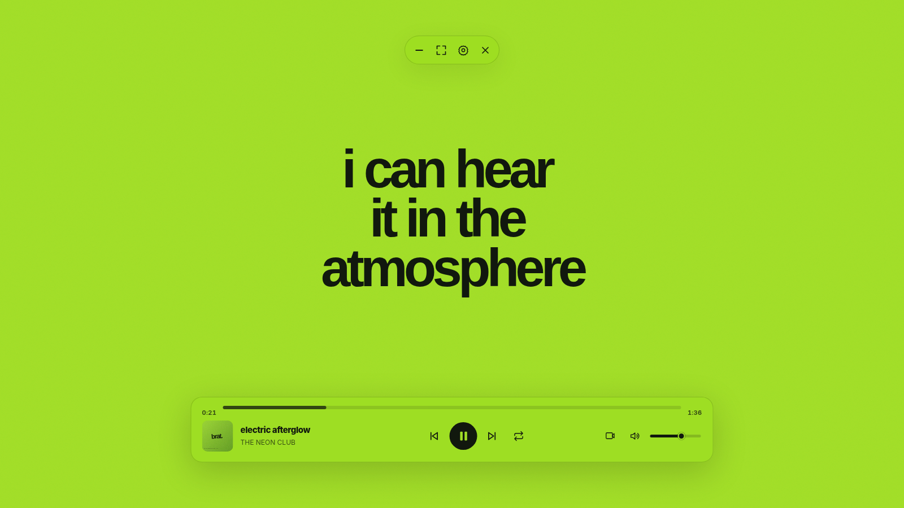
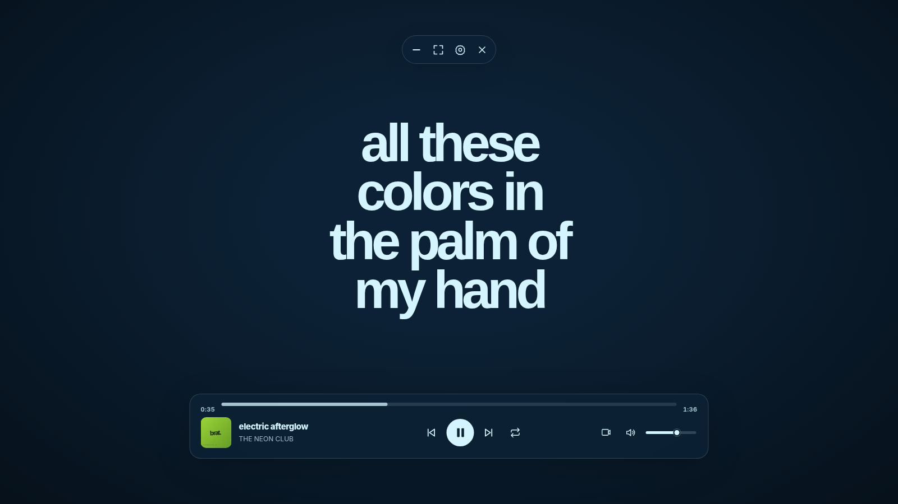
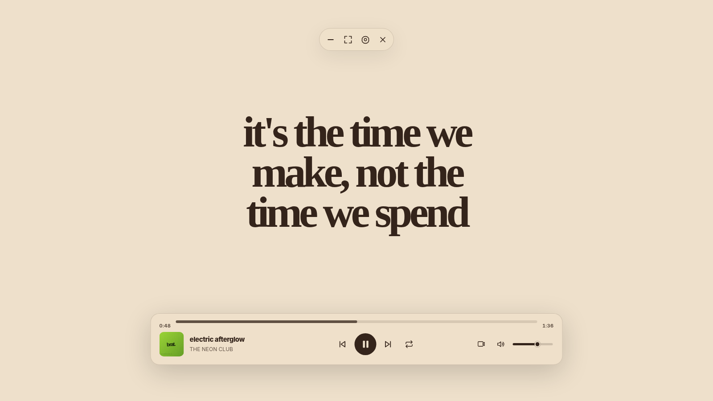

<div align="center">


# BRAT/STAGE

**Your music. Your words. Your entire screen.**

Immersive BRAT-style fullscreen lyrics with kinetic word reveals, cinematic colors, music-video backdrops, and a customizable auto-hiding player.

**Available for [Spicetify](https://spicetify.app/) + [SpotiKit](https://spotikit.com/).** One project, two native builds.

[**Install on SpotiKit**](https://spotikit.com/install/Tuguldurs526/brat-stage-spicetify) · [**View on GitHub**](https://github.com/Tuguldurs526/brat-stage-spicetify) · [**Report a bug**](https://github.com/Tuguldurs526/brat-stage-spicetify/issues)

</div>



*Actual user-supplied Spotify screenshot. Your colors and layout depend on your settings.*

## See it in motion

<div align="center">

</div>

*Animated browser preview with original demo lyrics and simulated playback. Real word timing depends on the song's lyric source.*

## What makes it different

| | |
|---|---|
| **Lyrics that move** | BRAT growing square, locked square, cinematic word reveals, spotlight, and stacked lyrics. |
| **Timing that tells the truth** | Uses word timestamps when available; line-only lyrics don't pretend to have word-level accuracy. |
| **Colors with character** | Curated color combinations, album-art colors, and lyric-line palette transitions. |
| **Your backdrop** | Solid, album blur, custom image/GIF, or optional YouTube music video. |
| **Disappearing controls** | Compact album/track dock, repeat, seek, volume, customizable auto-hide, optional cursor hiding. |
| **Built for tweaking** | Fonts, weights, animation, line count, sync offset, backdrop effects, and more. |

## Install

### SpotiKit (Windows)

1. Open **[BRAT/STAGE on SpotiKit](https://spotikit.com/install/Tuguldurs526/brat-stage-spicetify)**, or search for **BRAT/STAGE** in **Marketplace → Extensions**.
2. Click **Install**, then play a song in Spotify.
3. Press **`Alt+B`** or click the BRAT/STAGE icon in the playback bar.

> **Compatibility:** `spotikit.json` declares Spotify **1.3.8–1.3.9** as a *provisional target range* for Marketplace display. This package passed mocked integration tests, **not a live verification on every Spotify build**. Please report your exact Spotify version when reporting a compatibility problem.

### Spicetify (Windows / macOS / Linux)

Install BRAT/STAGE from **Spicetify Marketplace → Extensions**. For manual installation, copy [`bratstage.js`](bratstage.js) into your Spicetify `Extensions` folder, then run:

```powershell
spicetify config extensions bratstage.js
spicetify apply
```

Play a track, then press **`Alt+B`** or use the playback bar icon. The **Spicetify** build uses `bratstage.js`; the **native SpotiKit** build uses `dist/bratstage.spotikit.js`. Install only one version in a given Spotify client.

## Make it yours

Open the player with **`Alt+B`**, click the **gear** icon, and explore the controls. **`Alt+S`** opens settings while the player is visible.

**01. Pick your aesthetic**



**02. Make the lyrics feel right**



**03. Fine-tune motion and backgrounds**

<div align="center">


</div>

### Visual gallery

| Velvet / pink | Lime / BRAT |
|---|---|
|  |  |
| **Electric blue** | **Editorial cream** |
|  |  |

*Gallery previews are rendered in Chromium using BRAT/STAGE's real UI and a simulated player with original demo lyrics. They are not screenshots from a live SpotiKit installation.*

## Playback shortcuts

| Shortcut | Action |
|---|---|
| `Alt+B` | Open or close fullscreen lyrics |
| `Alt+S` | Open appearance settings while BRAT/STAGE is active |
| `Esc` | Close settings or exit the lyrics view |

The dock can fade away after an adjustable idle delay. Mouse movement reveals it again. You can configure hiding the cursor with the dock under **Motion**.

## Word sync and YouTube

The extension uses available timed lyrics (including TTML and enhanced LRC), with a clearly identified line-timed fallback. **Precise word reveals require actual word timestamps**. Adjust a song's sync offset under **Sync & Video** when a source is early or late.

Music videos are optional. You can paste a YouTube link for a track or configure **YouTube Data API v3** matching with your own key. Some uploads block embedding or autoplay, and captions may be controlled by YouTube rather than this extension.

## Privacy and troubleshooting

Settings, per-track offsets and video links are stored locally. API keys stay in local settings, are not added to exported presets, and are excluded from **Copy Safe Diagnostics**. External services are contacted only for the corresponding enabled features. This is an independent community extension, not affiliated with Spotify or YouTube.

If something doesn't work: open **Settings → Diagnostics**, use **Copy Safe Diagnostics**, and [open an issue](https://github.com/Tuguldurs526/brat-stage-spicetify/issues) with the Spotify version, platform, and reproduction steps. Never post your API keys.

## Developers

```bash
python scripts/build.py
node --check bratstage.js
node --check dist/bratstage.spotikit.js
node --test tests/core.test.js tests/core_v4.test.js
python tests/browser_dual.py
python tests/test_release.py
```

`src/` contains the maintained code. `scripts/build.py` generates both distribution files, which **must be committed** for Marketplace installs. `manifest.json` is for Spicetify, `spotikit.json` is for SpotiKit. The SpotiKit adapter uses its documented native player and toolbar APIs, including custom SVG icons and stop cleanup. [API reference](https://spotikit.com/docs/api).

## Enjoying BRAT/STAGE?

**⭐ [Star the GitHub repository](https://github.com/Tuguldurs526/brat-stage-spicetify)** if it's become part of your listening setup. It helps other people discover the project.

**✍️ Leave a review** on its **SpotiKit Marketplace** listing, or send constructive feedback via [GitHub Issues](https://github.com/Tuguldurs526/brat-stage-spicetify/issues). Screenshots and bug reports are especially helpful.

---

MIT licensed. Original project code and user-provided artwork/screenshots where identified. Audio, music videos, and lyric texts remain the property of their respective owners. See [LICENSE](LICENSE) and [CHANGELOG](CHANGELOG.md).
